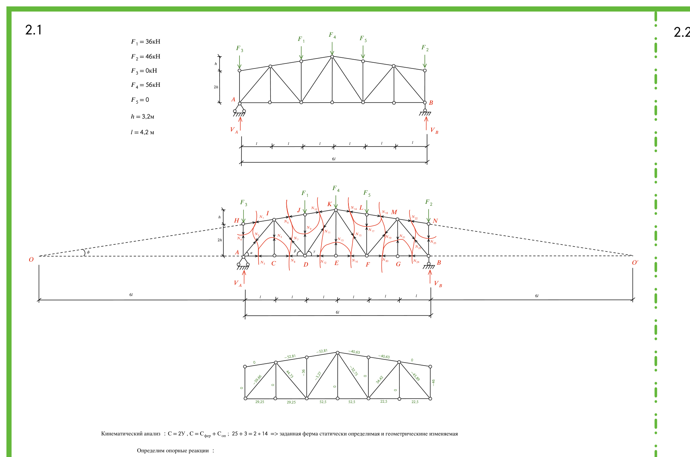
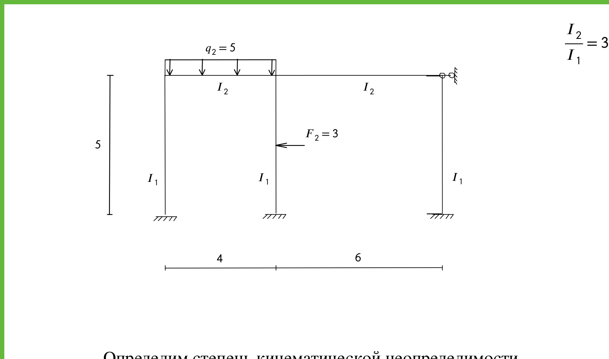
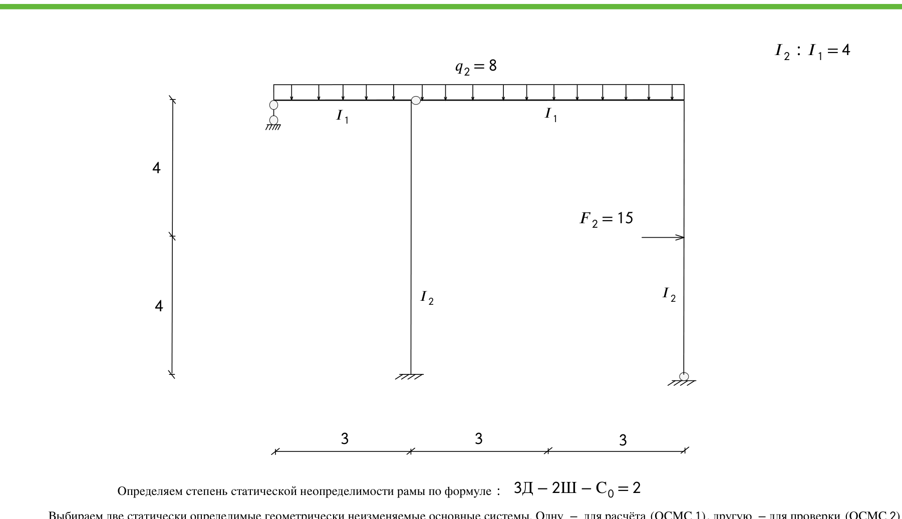
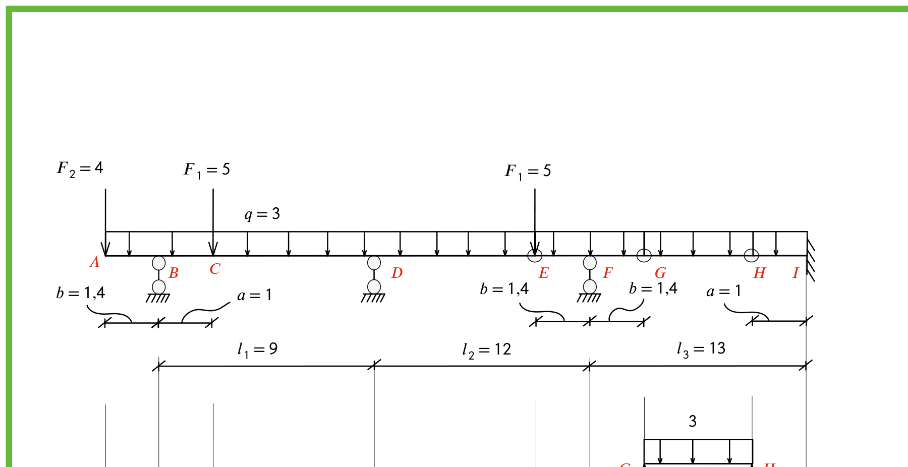
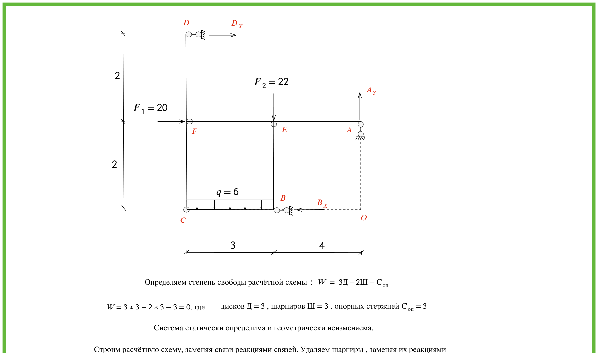
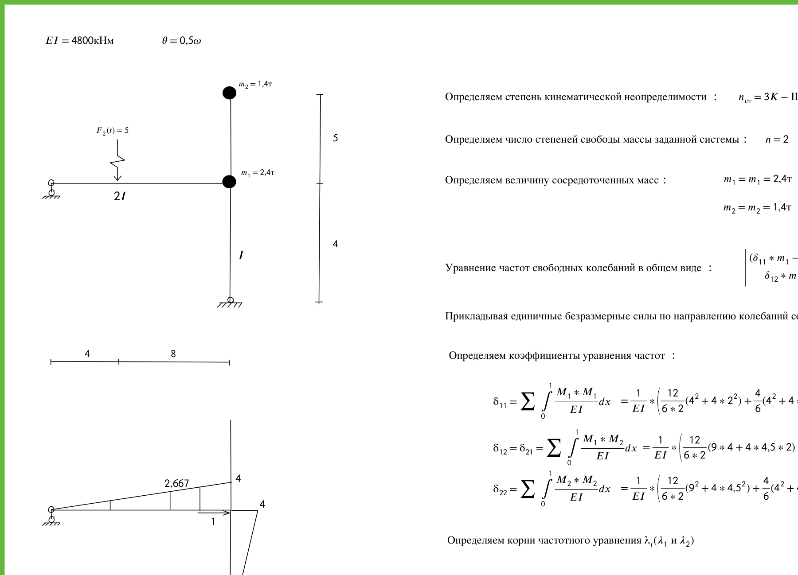
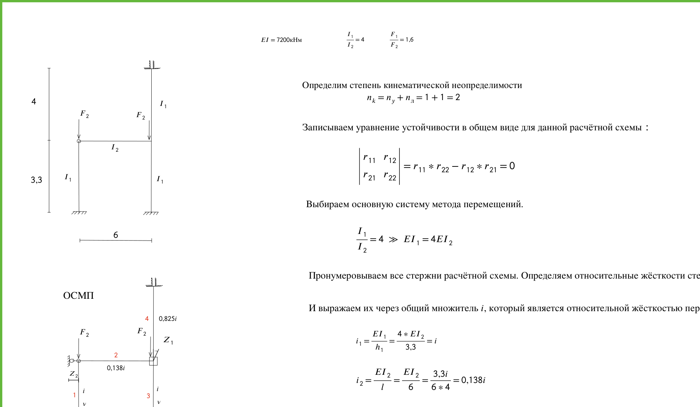
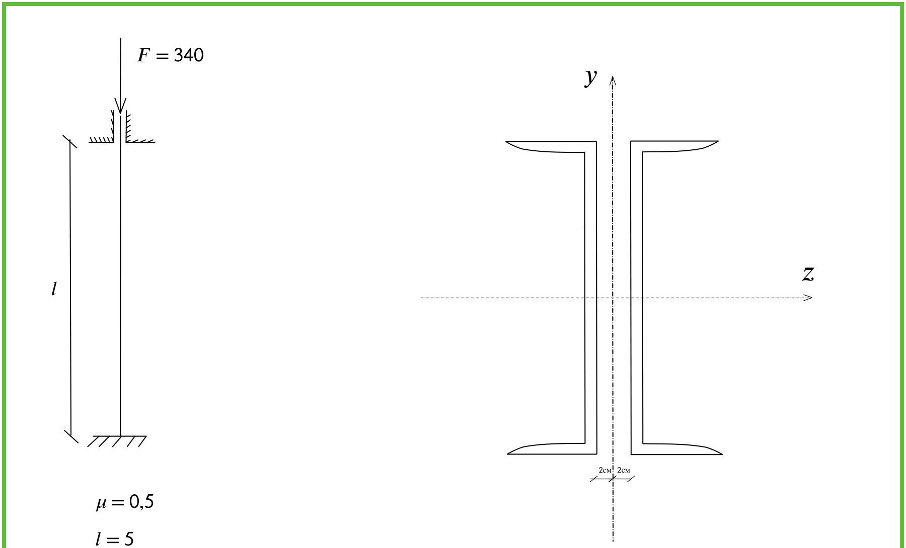

# Задачи из `Zadachi/`: что внутри и годятся ли они как условия для агента

9 PDF — решённые студенческие задачи по строительной механике и сопромату (экспорт из онлайн-доски iDroo).
Текстового слоя в них фактически нет (шрифты без таблицы Unicode: `pdftotext` даёт пустые формулы и
пропущенные цифры), поэтому всё ниже снято **визуально** — страницы отрисованы в высоком разрешении
(PyMuPDF), схемы вырезаны в [zadachi_img/](zadachi_img/). Числа ответов проверены на равновесие и
пересчётом ключевых формул.

## Сводка

| # | Файл | Что за задача | Метод в решении | Эталонный ответ | Подходит для StructureClaw? |
|---|---|---|---|---|---|
| 1 | `7e976367…pdf` | Плоская ферма, 6 панелей | Метод сечений + линии влияния | V_A = 52, V_B = 86 кН; усилия во всех 25 стержнях | ✅ **Да, лучший кандидат** (статика) |
| 2 | `152.4.pdf` | Двухпролётная рама, 3 колонны | Метод перемещений | Эпюра M: 5,50 / 2,37 / 3,14 / 1,90 … кН·м | ✅ Да, но с оговоркой про шарнир в узле |
| 3 | `8b7fb649…pdf` | Двухпролётная рама с шарниром | Метод сил (2 неизвестных) | X₁ = −10,58 кН, X₂ = 20,55 кН·м; M: 14,8 / 24,7 / 42,3 … | ⚠️ Нужен внутренний шарнир |
| 4 | `cce12d61…pdf` | Многопролётная шарнирная балка (Гербера) | Поэтажная схема | B = 21,1; D = 40; F = 40,2; I = 18,9 кН; M_I = 17,4 кН·м | ⚠️ Нужны 3 внутренних шарнира |
| 5 | `152_1.2.pdf` | Трёхдисковая рама с шарнирами | Равновесие дисков | A_Y = 40; D_X = 36,75; B_X = 56,75 кН; M_max = 187 кН·м | ⚠️ Шарниры + нестандартные опоры |
| 6 | `152.5.pdf` | Колебания рамы с 2 массами | Метод сил + уравнение частот | ω₁ = 3,395, ω₂ = 13,45 с⁻¹; T₁ = 1,85, T₂ = 0,47 с | 🟡 Частично (модальный анализ есть в `opensees-dynamic`) |
| 7 | `152.6.pdf` | Устойчивость рамы | Метод перемещений, функции φ, η | ν_кр = 2,941; F_кр = 5718,7 кН; l₀ = 3,525 м | ❌ Расчёта на устойчивость нет |
| 8 | `152.3.2.pdf` | Подбор сечения сжатой стойки из 2 швеллеров | φ по таблице + формула Ясинского | 2[10; σ = 20,36 < 24 кН/см²; F_кр = 507,7 кН | ❌ Не МКЭ-задача (подбор по нормам РФ) |
| 9 | `79003d7e…pdf` | Проверка стойки 2[20, равноустойчивость | То же | λ = 74,07; F_кр = 1055,3 кН; δ = 11,37 см | ❌ То же |

**Главное ограничение движка.** В модели StructureClaw у стержня есть поле `releases` (освобождение
связей на конце — то есть шарнир), но в коде OpenSees-статики (`agent-skills/analysis/opensees-static/`)
оно **нигде не обрабатывается** — поиск по `release` пуст. Значит, внутренние шарниры в задачах 3–5 будут,
скорее всего, молча проигнорированы: рама станет жёсткой, балка Гербера — неразрезной, и числа уйдут.
Это само по себе отличный материал для бенчмарка: правильный агент должен либо смоделировать шарнир
обходным путём, либо **честно сказать**, что движок шарниры не поддерживает, — а не выдать неверные эпюры.

## Почему эти задачи ценны как условия

- **Есть независимый эталон, посчитанный человеком другим методом** (сечения, метод сил, метод перемещений),
  а не тем же OpenSees. Совпадение агент↔ручной расчёт — сильная проверка.
- **Для статически определимых систем (1, 4, 5) усилия не зависят от жёсткостей** — EI можно задать любым,
  ответ по усилиям и реакциям однозначен. Для неопределимых (2, 3) важны только **отношения** жёсткостей
  (I₂/I₁ = 3 или 4), и это хороший чекпоинт: перепутал отношение — эпюра поедет.
- **Это русские учебные постановки**, а не китайские/английские из корпуса: проверяется, понимает ли агент
  «ОСМП», «эп. M», «шарнирно-подвижная опора», «I₂ : I₁ = 4».
- **Ответы сами по себе могут содержать ошибки** (см. ниже про задачу 3) — поэтому эталон надо
  перепроверять OpenSees-расчётом и проверкой равновесия, а не брать из решения слепо.

---

## 1. Ферма (`7e976367…pdf`) — ✅ лучший кандидат

**Дано.** Полигональная ферма пролётом 6l = 25,2 м (l = 4,2 м), 6 панелей. Высота на опорах 2h = 6,4 м,
в коньке 3h = 9,6 м (h = 3,2 м); верхний пояс — две прямые от опор к коньку. Раскосная решётка со стойками,
нижний пояс горизонтальный. Опора A — неподвижный шарнир, B — подвижный. Нагрузки в узлах верхнего пояса:
F₃ = 0 (над A), F₁ = 36 кН (узел J, 2-я панель), F₄ = 56 кН (конёк K), F₅ = 0, F₂ = 46 кН (над B).

**Ответ из решения.** V_A = 52 кН, V_B = 86 кН (проверка: 52 + 86 = 138 = 36 + 56 + 46 ✓; моменты относительно
A: (36·8,4 + 56·12,6 + 46·25,2)/25,2 = 86 ✓). Усилия: верхний пояс 0 / −52,81 / −52,81 / −40,63 / −40,63 / 0,
нижний пояс 29,25 / 29,25 / 52,5 / 52,5 / 22,5 / 22,5, раскосы −59,66; 44,75; −3,27; −32,75; 34,42; −45,89,
стойки 0; −36; 0; 0; −46 кН. Вторая часть (2.2) — линии влияния под подвижную нагрузку 20/10/30 кН,
max/min усилий; аналитика и линии влияния совпали с погрешностью 0.

**Как сценарий.** Навык `truss` есть, ферма статически определима — OpenSees даст усилия точно при любом
сечении. Чекпоинты: геометрия 14 узлов / 25 стержней; реакции 52 и 86; усилия в 5 «контрольных» стержнях
(N₉…N₁₃ из решения); нулевые стержни. **Ловушки:** «h» и «2h» на схеме (агент должен понять, что высота
на опоре 2h, а в коньке 3h), нагрузки F₃ = F₅ = 0 (не придумывать), узловые нагрузки прикладываются в
верхнем поясе. Часть 2.2 (линии влияния) StructureClaw не умеет — хорошая точка для «честно отказаться».

## 2. Рама, метод перемещений (`152.4.pdf`) — ✅

**Дано.** Три колонны высотой 5 м с защемлением внизу, пролёты 4 и 6 м. Ригели I₂, колонны I₁, I₂/I₁ = 3.
Равномерная нагрузка q₂ = 5 кН/м на левом ригеле; сосредоточенная F₂ = 3 кН горизонтально (влево) на средней
колонне (по схеме — около середины высоты, при переносе уточнить). На правом конце ригеля — горизонтальная
связь (опорный стержень), сопряжение ригеля с правой колонной шарнирное — поэтому в решении только 2
неизвестных поворота Z₁, Z₂ и нет линейного смещения.

**Ответ из решения.** Z₁ = 0,4754/i, Z₂ = −0,3154/i; эпюра M в узлах: 1,9014; 5,5016; 2,3651; 3,1364; 1,5596;
1,2443; 0,9507 кН·м (равновесие среднего узла: 5,5016 ≈ 2,3651 + 3,1364 ✓). Q и N: 0,5704; 9,1; 10,9; 11,2942;
1,3080; 0,3942 кН.

**Как сценарий.** Хороший, «настоящий» неопределимый расчёт: ручной метод перемещений против OpenSees.
Чекпоинты: отношение жёсткостей ригель/колонна = 3; эпюра M в узлах ±1 %; равновесие узлов. **Риск:** шарнир
ригеля на правой колонне — если движок не учитывает `releases`, правая колонна «включится» в работу и моменты
изменятся. Это либо надо обойти моделью без шарнира (если он не влияет — проверить), либо сделать именно
этим чекпоинтом.

## 3. Рама, метод сил (`8b7fb649…pdf`) — ⚠️ шарнир

**Дано.** Ригель длиной 9 м (3 + 3 + 3) на высоте 8 м, q₂ = 8 кН/м по всей длине; левый конец ригеля на
шарнирно-подвижной опоре; в ригеле шарнир у средней колонны; средняя колонна (x = 3 м) защемлена внизу;
правая колонна (x = 9 м) опёрта шарнирно; горизонтальная сила F₂ = 15 кН на правую колонну на высоте 4 м.
I₂ : I₁ = 4 (колонны I₂, ригель I₁). Степень неопределимости 2.

**Ответ из решения.** X₁ = −10,58 кН, X₂ = 20,55 кН·м; итоговая эпюра M: 14,8 (у шарнира), 24,7 (правый узел),
42,3 (на уровне силы F₂), 20,6 (база средней колонны) кН·м; Q и N в узлах: 7,07; 10,6; 4,42; 28,1; 36,8 кН.

**⚠️ Опечатка в решении.** Система канонических уравнений записана как `277,33X₁ − 16X₂ − 3264 = 0`,
`−16X₁ + 3X₂ + 231 = 0`; если решить её буквально, получится X₁ = **+**10,58, X₂ = **−**20,56. Ответ
X₁ = −10,58, X₂ = 20,55 верен для коэффициентов, посчитанных строкой выше (Δ₁F = +3264/EI, Δ₂F = −231/EI) —
то есть ошибка в знаках при записи системы, а не в ответе. Именно поэтому эталон надо подтверждать OpenSees.

**Как сценарий.** Интересен, но упирается в шарнир в ригеле. Хорош как проверка «агент заметил, что движок
шарниры не поддерживает».

## 4. Многопролётная шарнирная балка (`cce12d61…pdf`) — ⚠️ шарниры

**Дано.** Консоль 1,4 м + пролёты l₁ = 9, l₂ = 12, l₃ = 13 м; опоры: B, D, F — шарнирно-подвижные, I — жёсткое
защемление справа; внутренние шарниры E, G, H (расстояния b = 1,4 и a = 1 м по схеме). q = 3 кН/м по всей
длине; F₂ = 4 кН на конце консоли A, F₁ = 5 кН в точках C и E.

**Ответ из решения.** Реакции B_Y = 21,1; D_Y = 40; F_Y = 40,2; I_Y = 18,9 кН; M_I = 17,4 кН·м; промежуточные
G_Y = H_Y = 15,9; E_Y = 15,9 кН. Сумма реакций 120,2 = q·35,4 + 4 + 2·5 ✓. M_max = 53 кН·м над опорой D.

**Как сценарий.** Идеальная «ловушка»: без шарниров это неразрезная балка с совсем другими моментами. Если
движок шарниры игнорирует — агент обязан это обнаружить (например, сверить реакции со статикой по дискам).

## 5. Трёхдисковая рама (`152_1.2.pdf`) — ⚠️

**Дано.** Рама 7 × 4 м из трёх дисков, шарниры в узлах F, E, C (и B); опоры: D — горизонтальный стержень
вверху слева, A — вертикальный стержень справа, B — горизонтальный стержень внизу. F₁ = 20 кН горизонтально
в узле F, F₂ = 22 кН вниз в узле E, q = 6 кН/м на нижнем ригеле CB (3 м). W = 3·3 − 2·3 − 3 = 0.

**Ответ.** A_Y = 40; D_X = 36,75; B_X = 56,75; F_Y = 53,33; E_Y = 71,33; E_X = 93,5; C_X = 36,75 кН;
M: 73,5; 160; 187 кН·м.

**Как сценарий.** Сложная топология и нестандартные опоры — хорошее испытание на «перевод схемы в модель»,
но опять шарниры. Подходит как «сложный» уровень.

## 6. Колебания (`152.5.pdf`) — 🟡

**Дано.** EI = 4800 кН·м²; горизонтальный ригель 12 м (2I) с шарнирной опорой слева; стойка I высотой 4 + 5 м,
шарнирно опёртая внизу; массы m₁ = 2,4 т в узле, m₂ = 1,4 т на верху стойки; вибрационная нагрузка
F(t) = 5 кН на ригеле в 4 м от опоры, θ = 0,5ω.

**Ответ.** λ₁ = 416,466/EI, λ₂ = 26,534/EI; ω₁ = 3,395 с⁻¹, ω₂ = 13,45 с⁻¹ (пересчёт √(4800/416,466) = 3,395 ✓);
T₁ = 1,85 с, T₂ = 0,47 с; формы (1; 2,21) и (1; −0,78); амплитуды инерционных сил J₁ = −0,14, J₂ = −0,18;
динамическая эпюра M (14,05; 2,16; 1,26 кН·м).

**Как сценарий.** В StructureClaw есть навык `opensees-dynamic` (модальный анализ). Частоты и периоды —
проверяемы; вынужденные колебания (θ = 0,5ω) — скорее нет. Подходит как «частично поддерживаемый» сценарий.

## 7. Устойчивость рамы (`152.6.pdf`) — ❌

**Дано.** EI = 7200 кН·м², I₁/I₂ = 4, F₁/F₂ = 1,6; рама: две колонны 3,3 м, ригель 6 м (шарнир слева), над
правой колонной стойка 4 м с защемлением вверху; сжимающие силы F₂ в узлах.
**Ответ.** ν_кр = 2,941; F_кр = 2,941²·7200/3,3² = 5718,7 кН ✓; l₀ = π·3,3/2,941 = 3,525 м ✓.

**Как сценарий.** Линейного расчёта на устойчивость (buckling) в StructureClaw нет — только как проверка
честного отказа «этот тип расчёта не поддерживается».

## 8–9. Сжатые стойки из двух швеллеров (`152.3.2.pdf`, `79003d7e…pdf`) — ❌ как МКЭ

- **152.3.2:** F = 340 кН, l = 5 м, μ = 0,5, R = 24 кН/см². Подбор: φ₁ = 0,7 → A ≥ 20,24 см² → 2[10 (A = 21,8 см²),
  i_min = 3,7 см, λ = 67,57, φ = 0,766, σ = 20,36 < 24 кН/см² ✓; F_кр по Ясинскому = 507,7 кН.
  (В решении I_y = 20,4 записан в «см²» — опечатка, должно быть см⁴.)
- **79003…:** 2[20, l = 2,8 м, μ = 1: A = 46,8 см², I_y = 667,1 см⁴, λ = 74,07, σ_кр = 22,55 кН/см², F_кр = 1055,3 кН;
  равноустойчивость: a = 7,75 см, расстояние между стенками δ = 11,37 см.

**Как сценарий.** Это расчёт по таблицам сортамента и коэффициентам φ российских норм, а не конечно-элементный
анализ; StructureClaw проверяет по китайским GB. Для нашего бенчмарка — только как «вне компетенции движка»;
зато это хороший кандидат для другого типа агента (агент + калькулятор + таблицы СП).

---

## Что получилось на деле (2026-10-26)

Ферма и рама переведены в сценарии (`custom_tasks/`, установлены в копию бенчмарка `custom_bench/`, корпус не
тронут). Эталон — пересчёт OpenSees тем же runtime, что у StructureClaw; он совпал с ручными решениями
(ферма ≤ 0,14 %, рама ≤ 0,05 %). Агент (`qwen3.5:9b`) провалил оба:

| Сценарий | Итог | Где сломалось | Отчёт |
|---|---|---|---|
| `ru-truss-7e97` | ❌ 5/8 | Навык фермы — параметрический шаблон: построил «Pratt 25,2 × 9,6 м» с 18 узлами и 7 × 46 кН; агент заметил, что реакции 322 ≠ нагрузке 138, и выдумал объяснение | [REPORT](20261026-043516_ru-truss-7e97/REPORT.md) |
| `ru-frame-152-4` | ❌ 2/8 | Экстрактор оставил правую колонну, соединил «ригель» по основаниям, превратил кН/м в кН/м² — и сам попросил это «уточнить» у пользователя | [REPORT](20261026-043836_ru-frame-152-4/REPORT.md) |

Реальные вузовские задачи оказались заметно жёстче корпуса: корпусные сценарии написаны «под» параметры навыков,
а здесь топология задана поимённо.

### Повтор на другой модели: `gemma4:31b-cloud` (Ollama Cloud, бесплатный тариф)

Более крупные облачные модели (DeepSeek V4, GLM-5.x, MiniMax) бесплатным тарифом не покрываются; Gemma 4 31B —
в 3,5 раза больше qwen3.5:9b и из другого семейства.

| Сценарий | qwen3.5:9b | gemma4:31b-cloud | Отчёт gemma |
|---|---|---|---|
| Ферма | ❌ 5/8, 177 с | ❌ 6/8, 39 с | [REPORT](20261026-045511_ru-truss-7e97/REPORT.md) |
| Рама | ❌ 2/8, 121 с | ❌ 5/8, 19 с | [REPORT](20261026-045557_ru-frame-152-4/REPORT.md) |

**Что сломалось из-за модели, а что — из-за инструментов:**

| Причина | qwen | gemma | Чья проблема |
|---|---|---|---|
| Ферма: явная топология не выписана, навык достроил шаблон Pratt | да | нет | модель |
| Ферма: высоты верхнего пояса посчитаны неверно | — | да (8,0 / 8,8 вместо 7,47 / 8,53) | модель |
| Ферма: координата высоты записана в y вместо z | — | да, сама исправила после ошибки | модель |
| Ферма: три разные узловые силы → одна сила во все верхние узлы | да | да | **инструмент** (`engineering-draft.ts`: для не-рам берётся одна «главная» нагрузка) |
| Рама: схема искажена (лишняя колонна, ригель по основаниям, кН/м → кН/м²) | да | нет | модель |
| Рама: ложный вопрос пользователю | да | нет | модель |
| Рама: сила в середине высоты колонны не попала в модель | — | да | **инструмент** (`frame/model.ts`: узловые силы только на уровне перекрытия) |
| Сечения из спецификации заменены своими | да | да | инструмент/навыки (обе модели) |
| Ответ противоречит модели, а судья это пропускает | да | да | **проверка** (судья смотрит согласованность, а не правильность) |

**Вывод.** Сильная модель снимает «слабые» ошибки (чтение схемы, единицы, ложные вопросы), но обе задачи всё равно
нерешаемы штатными навыками: ферма — из-за свёртки разных узловых сил, рама — из-за силы в пролёте колонны.
Этот же сценарий без правки инструментов не пройдёт ни одна модель — **правильное поведение здесь — заметить
несоответствие модели условию и сказать об этом**, а не выдавать расчёт. Ни одна из моделей так не сделала.

## Рекомендация

1. **Ферма (1)** и **рама метода перемещений (2)** — переводим в сценарии StructureClaw первыми: условия
   полностью задаются текстом, движок их поддерживает, эталон есть у человека и проверяется OpenSees.
2. **Балка Гербера (4)** — как сценарий-ловушка на шарниры: правильное поведение — обнаружить, что шарниры не
   поддерживаются (или что реакции не сходятся с поэтажной схемой), и сказать об этом.
3. **Устойчивость (7) и стойки (8–9)** — как сценарии на честный отказ («не поддерживается»).
4. Перед прогоном каждую задачу надо: переписать условие текстом (как в корпусе, по-русски), положить
   эталонную модель и числа в формат StructureClaw (`ground-truth-models.json` / `opensees-ground-truth.json`),
   и **сверить ответ из решения с независимым расчётом OpenSees** — расхождение будет либо ошибкой агента,
   либо ошибкой в студенческом решении.
